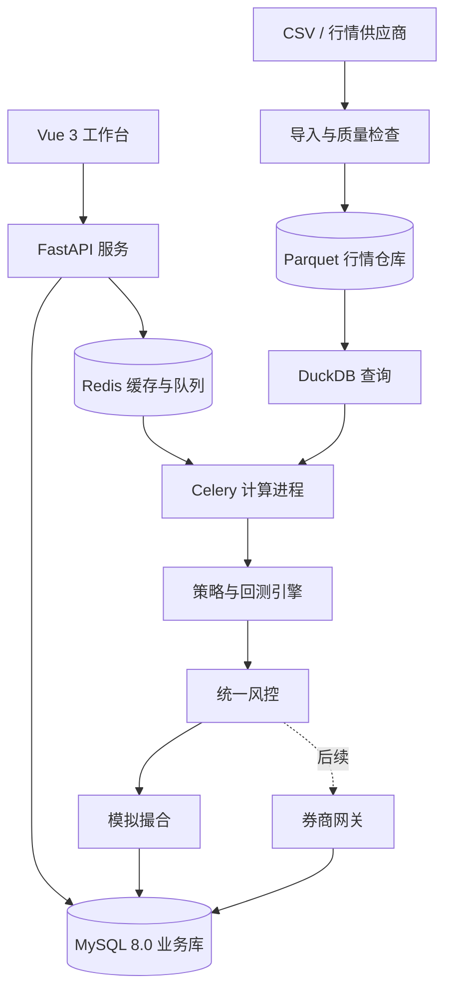

# A 股量化交易平台技术方案

> 版本：V1.1  
> 状态：第一阶段开发中  
> 更新日期：2026-11-10  
> 默认范围：单用户、A 股日线、历史回测、模拟交易，预留实盘接口。

## 1. 建设目标

平台提供行情管理、股票池、策略版本、历史回测、模拟交易、账户持仓和统一风控。第一阶段建立“数据导入—策略配置—历史回测—结果分析—模拟运行”闭环；实盘作为独立里程碑。

首版不包含高频交易、融资融券、期权、公开跟单和多券商交易。

## 2. 功能模块

| 模块 | 主要功能 |
|---|---|
| 工作台 | 资产、收益、回撤、策略状态、持仓、告警 |
| 行情中心 | 股票资料、日 K 线、交易日历、数据质量与版本 |
| 股票池 | 静态名单、指数成分、历史成员 |
| 策略中心 | 模板、参数、版本、运行状态 |
| 回测中心 | 异步任务、绩效、净值、成交、结果比较 |
| 模拟交易 | 模拟账户、委托、成交、撤单、资金与持仓 |
| 风控中心 | 仓位、金额、频率、回撤、黑名单、紧急停止 |
| 系统管理 | 用户权限、数据源、费用、任务、审计日志 |

首批策略建议为双均线、横截面动量和指数定期再平衡。策略输出信号或目标仓位，由组合模块生成订单。

## 3. 总体架构



后端采用模块化单体，回测和数据任务进入独立 Worker。券商网关以后使用独立进程，避免研究任务影响交易链路。

## 4. 技术选型

| 层级 | 技术 |
|---|---|
| 前端 | Vue 3、TypeScript、Vite、Element Plus、ECharts |
| API | Python 3.12、FastAPI、Pydantic、SQLAlchemy |
| 数据库 | MySQL 8.0、InnoDB |
| 迁移 | Alembic 或 Flyway，项目启动时二选一 |
| 行情分析 | Parquet、DuckDB、pandas、NumPy |
| 异步任务 | Celery、Redis |
| 部署 | Docker Compose、Nginx |
| 监控 | Prometheus、Grafana、结构化日志 |

选择 MySQL 的正式记录见 [数据库选型.md](数据库选型.md)。团队熟悉度是主要依据；大规模行情查询由 DuckDB 承担。

## 5. 数据存储分工

- MySQL：用户、权限、策略元数据、回测任务与摘要、账户、订单、成交、持仓、资金流水、风控事件、审计日志。
- Parquet：日线、复权因子、公司行动和批量因子数据，按数据集、市场、年份分区。
- DuckDB：直接分析 Parquet，执行批量研究查询。
- Redis：缓存、分布式锁和任务消息，不保存最终账本。

核心实体包括 `instrument`、`trading_calendar`、`dataset_version`、`universe`、`strategy_version`、`backtest_run`、`account`、`order`、`trade`、`position`、`cash_ledger`、`risk_event` 和 `audit_log`。

金额和价格使用 `DECIMAL`。订单、成交和资金流水为不可变记录；持仓是可以由账本重建的当前快照。

## 6. MySQL 设计要求

- 默认引擎 InnoDB，字符集 `utf8mb4`。
- 订单客户端编号建立账户内唯一索引，避免重复下单。
- 外键用于稳定核心关系；高吞吐明细表是否使用外键在压测后决定。
- 账户与持仓更新采用版本号或带条件更新，防止并发覆盖。
- 事务代码保持短小，并按账户、证券、订单的固定顺序加锁。
- 捕获死锁并对幂等事务进行有限次数重试。
- 高频增长表按日期或账户评估分区，不能只为了“可能变大”提前分区。
- 复杂回测明细可以输出 Parquet，MySQL 保存索引、摘要和访问位置。

## 7. 行情数据与版本

统一数据适配器隔离供应商差异。导入流程为：原始文件留存、字段映射、类型检查、交易日对齐、重复与缺失检测、生成版本、发布版本。

检查内容包括代码与日期唯一性、OHLC 关系、负值、非交易日记录、缺失交易日、停牌、除权除息以及上市退市状态。

数据修订生成新版本，不覆盖已用于回测的数据。每次回测保存数据版本、策略版本、参数、费用和撮合规则，确保结果可复现。

## 8. 策略模型

策略读取当前时间之前可见的行情、股票池、账户快照和参数，输出目标权重、目标仓位或交易信号。策略不能直接调用模拟或实盘网关。

策略版本由代码哈希、参数结构、依赖环境和创建时间确定。第一版只运行内置模板；以后开放 Python 策略时必须使用隔离容器，并限制 CPU、内存、运行时间、网络和依赖。

## 9. 回测与撮合

每个交易日依次执行：装载证券状态、处理公司行动、处理待成交订单、更新账户、向策略发布可见数据、计算信号、生成订单、执行风控、记录日终状态。

日线策略默认使用 T 日收盘数据产生信号，在 T+1 日按照配置的开盘价或成交模型撮合，避免未来数据。

撮合模型至少处理：

- 停牌、涨跌停和无涨跌幅限制状态。
- 可卖数量与买入后的可卖时间。
- 最小申报单位及卖出余股。
- 限价、滑点、成交量参与率和部分成交。
- 佣金、印花税、过户费及其生效日期。
- 主板、创业板、科创板和特殊证券规则差异。

规则按交易所、板块、证券类型和生效日期配置，不能将当前规则硬编码到所有历史时期。参考：[上交所交易规则（2026 年修订）](https://www.sse.com.cn/lawandrules/sselawsrules2025/stocks/exchange/c/c_20260424_10816482.shtml)。

回测报告包含累计和年化收益、波动率、最大回撤、夏普、索提诺、Calmar、胜率、盈亏比、换手率、费用、集中度及相对基准收益。

## 10. 订单、账户与账本

订单状态：`CREATED → RISK_REJECTED / ACCEPTED → PARTIALLY_FILLED → FILLED / CANCELLED / EXPIRED`。状态迁移写入订单事件表。

成交驱动资金和持仓记账。一笔成交涉及的成交记录、订单累计量、资金流水和持仓更新必须在同一数据库事务中完成；无法同步完成的外部回报采用 Inbox 表去重并在本地事务中处理。

日终校验订单与成交汇总、资金与流水、持仓与成交、平台与券商账户快照。差异进入告警，不自动修改历史流水。

## 11. 风控

事前检查证券状态、资金、可卖数量、单笔金额、个股和行业仓位、价格偏离、频率和黑名单。事中监控成交额、撤单率、连续拒单、策略亏损、账户回撤、数据延迟和网关心跳。事后完成对账、风险暴露和审计复核。

紧急停止支持策略、账户和系统三级，阻止新订单并尝试撤销可撤订单。是否卖出持仓由单独指令决定。

## 12. API

接口前缀 `/api/v1`，关键写请求包含请求 ID 和幂等键：

```text
GET    /instruments
GET    /market-data/bars
POST   /data-imports
POST   /strategies
POST   /strategies/{id}/versions
POST   /backtests
GET    /backtests/{id}/report
POST   /paper-accounts
POST   /strategy-runs
POST   /strategy-runs/{id}/stop
GET    /accounts/{id}/positions
GET    /accounts/{id}/orders
POST   /orders/{id}/cancel
GET    /risk-events
GET    /audit-logs
```

回测返回 `202 Accepted` 和任务 ID。任务状态为 `PENDING、RUNNING、SUCCEEDED、FAILED、CANCELLED`。

## 13. 安全与合规

使用 HTTPS、密码哈希、短期令牌、RBAC 和后端权限校验。密钥通过环境或密钥服务注入；日志不得记录密码、完整令牌和券商密钥。关键操作保存不可篡改的审计记录，并定期备份和验证恢复。

实盘前需根据券商和现行规则完成程序化交易报告等事项。参考：[上交所程序化交易管理实施细则](https://www.sse.com.cn/lawandrules/sselawsrules2025/trade/universal/c/c_20250612_10781696.shtml)和[证监会程序化交易管理规定](https://www.csrc.gov.cn/csrc/c100028/c7480577/content.shtml)。

## 14. 部署与监控

Docker Compose 包含 `web、api、worker、scheduler、mysql、redis、nginx`。开发、测试、模拟生产和实盘生产使用不同数据库、密钥和账户。

监控 API 延迟、错误率、队列长度、回测耗时、行情更新时间、策略心跳、订单延迟、拒单率、对账差异、MySQL 连接数、锁等待、死锁和慢查询。

## 15. 测试与验收

- 单元测试费用、仓位、复权、指标和风控规则。
- 固定小数据集回归测试订单、成交、净值和指标。
- 验证同一版本和参数的回测结果一致。
- 验证停牌、涨跌停、可卖数量、部分成交和重复请求。
- 验证资金与持仓账本守恒。
- 测试 Worker 中断、Redis 重启、MySQL 死锁、网关断线和回报重复。
- 验证权限和审计覆盖关键操作。

## 16. 开发计划

| 阶段 | 建议周期 | 交付 |
|---|---:|---|
| 需求确认 | 2–3 天 | 用户、数据源、频率、策略和部署确认 |
| 基础框架 | 1 周 | 前后端、MySQL、权限、队列、部署 |
| 数据中心 | 1–2 周 | 证券资料、日线导入、版本与质量报告 |
| 回测闭环 | 2–3 周 | 策略、事件引擎、撮合、费用和报告 |
| 模拟交易 | 2 周 | 账户、订单、账本、风控和对账 |
| 稳定验收 | 1 周 | 回归、故障、性能、安全与运维文档 |
| 实盘接入 | 另行评估 | 券商网关、合规、联调和小额灰度 |

## 17. 待确认项

开发前仍需确认：单人或多人、日线或分钟线、数据源、首批策略与基准、部署环境、是否已有券商接口、是否计划实盘。

未确认时采用：单用户、日线、CSV/Parquet、沪深 A 股、内置策略、本地 Docker、MySQL 8.0、模拟交易。

## 18. 当前实现状态

已实现 `backend/stock_selection` 选股研究核心：

- CSV 日线加载与字段校验。
- ST、停牌、上市天数、价格和流动性过滤。
- 动量、趋势、低波动、低回撤、流动性和可选质量因子排名。
- 定期等权调仓、交易成本、净值和绩效计算。
- 年化收益、最大回撤和调仓周期胜率门槛检查。
- 最新选股及因子明细 JSON 输出。
- 基础回归测试。
- 沪深主板与创业板权限股票池过滤。
- Tushare 股票资料、交易日历、日线和复权因子同步适配器。

默认门槛为年化收益 12%、最大回撤 15%、调仓周期胜率 55%。门槛可以配置，是否通过必须在多市场阶段和独立样本外数据中验证，不能用作未来收益承诺。
